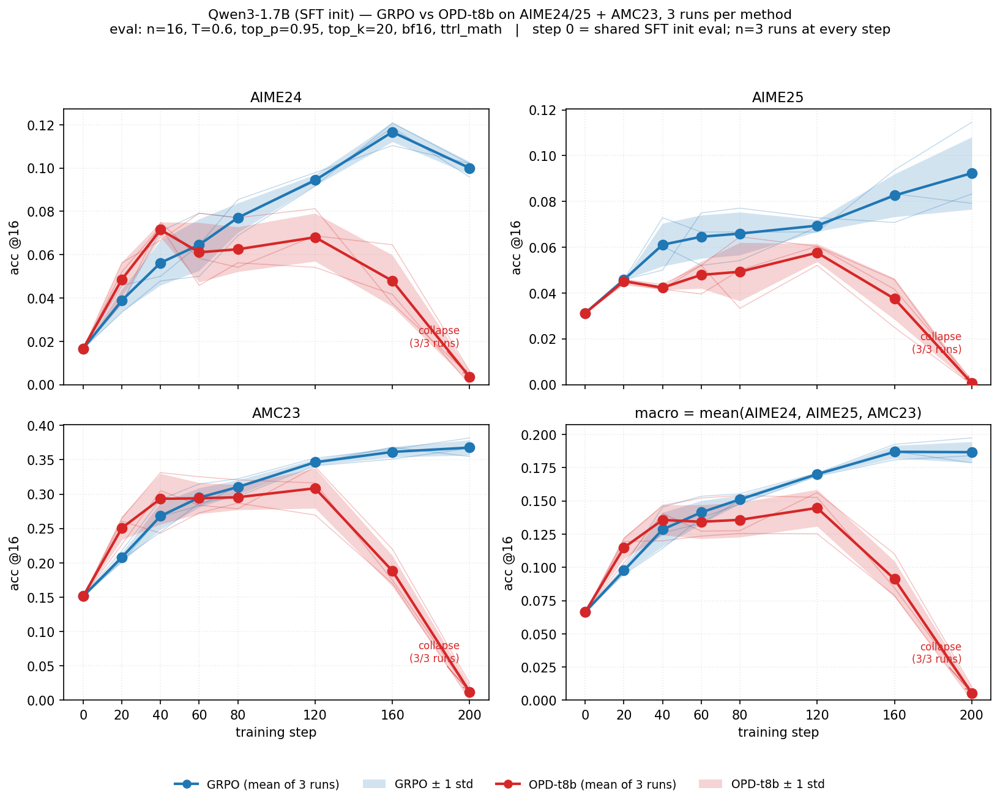

# Reproducing the 1.7B OPD-vs-GRPO suite

This directory contains everything needed to reproduce our **Qwen3-1.7B On-Policy
Distillation (OPD) vs. GRPO** experiment suite on DAPO-Math, evaluated on
AIME24 / AIME25 / AMC23.

Both methods start from the **same** SFT student checkpoint and use identical data,
lengths, batch sizes, learning rate, and step budget. The only differences are the
objective (GRPO outcome reward vs. OPD reverse-KL distillation from an 8B teacher)
and the GPU split (8 train / 0 teacher vs. 4 train / 4 teacher).

> **Starting point.** Public upstream **verl** at commit **`7aed6b2`**
> (`verl 0.8.0.dev0`), which already contains the OPD (on-policy distillation)
> trainer. On top of that commit you need exactly two additions, both shipped here:
> (1) a one-file patch, `patches/losses_global_batch_info.patch`, and (2) the
> `ttrl_math` math-grader reward module, `code_snapshot/verl/utils/reward_score/ttrl_math/`.
> See [`docs/CODE_PATCH.md`](docs/CODE_PATCH.md).

---

## Directory layout

```
unpack_opd_vs_grpo/
├── README.md                     # this file
├── docs/
│   ├── PROMPTS.md                # exact train + eval prompt templates (verbatim)
│   ├── ENVIRONMENT.md            # deps, pinned versions, install commands, hardware
│   ├── CODE_PATCH.md             # verl base commit + patch + added files + OPD file map
│   └── SFT.md                    # how the (unreleased) SFT student was trained
├── results/                      # expected results: plot (png/pdf) + raw eval_metrics.json
├── configs/
│   ├── grpo_seed123_dryrun.txt   # fully-resolved GRPO arg list (DRY_RUN of the launcher)
│   └── opd_8b_seed123_dryrun.txt # fully-resolved OPD  arg list (DRY_RUN of the launcher)
├── scripts/
│   ├── run_qwen3_1p7b_tml_opd_dapo_math_seed.sh  # the launcher (GRPO and OPD)
│   ├── train_seeds.sh                              # trains seeds 42, 123, 456 serially (METHOD=grpo|opd)
│   ├── run_standalone_eval.sh                      # merges FSDP shards + one val pass
│   ├── write_eval_metrics.py                       # helper: writes validation/metrics.json
│   ├── eval_seeds.sh                               # gated post-training eval of every seed run (METHOD=grpo|opd)
│   └── run_all.sh                                  # top-level "how to reproduce" wrapper
├── patches/
│   ├── losses_global_batch_info.patch  # the one change to upstream verl code
│   └── GIT_STATE.txt                   # base commit + what we add on top
├── code_snapshot/
│   └── verl/
│       ├── trainer/distillation/       # reference copy (upstream @7aed6b2, losses.py patched)
│       ├── workers/config/distillation.py   # reference copy (upstream, unchanged)
│       └── utils/reward_score/ttrl_math/     # NEW: \boxed{} math grader — copy into your checkout
└── dataset/
    ├── build_opd_eval_train_prompt.py  # builder for the AIME/AMC eval parquets
    ├── train/
    │   ├── dapo_math_17k_train_17661.parquet   # training set (17,661 rows)
    │   └── heldout_256.parquet                 # 256 rows held out from DAPO-Math-17k
    └── eval/
        ├── aime24.parquet  (30 rows)
        ├── aime25.parquet  (30 rows)
        └── amc23.parquet   (83 rows)
```

---

## 0. Hardware

Single node, **8 GPUs** with ≥80 GB each (we used H200s). GRPO uses all 8 GPUs for training; OPD splits
them **4 train + 4 teacher** (teacher = Qwen3-8B served by vLLM, tp=2, 2 replicas).

## 1. Code & environment

See [`docs/ENVIRONMENT.md`](docs/ENVIRONMENT.md) for the full setup. In short:

- Use **verl's released environment**: follow
  <https://verl.readthedocs.io/en/latest/start/install.html> — e.g. the DockerHub
  **vLLM** image `verlai/verl:vllm011.latest`, or from source
  `pip3 install -e ".[vllm]"` (verl requires vLLM ≥ 0.18). Everything uses vLLM.
  (For reference, our runs used torch 2.11.0+cu130 / vllm 0.20.2 / transformers 5.3.0
  / ray 2.55.1 / flash_attn 2.8.3 — see `docs/ENVIRONMENT.md`.)
- Check out verl at the pinned commit, apply the patch, and add the reward module:
  ```
  git clone https://github.com/volcengine/verl.git && cd verl
  git checkout 7aed6b230776f963fa09509c10d9c3a767d1102c
  git apply <this-package>/patches/losses_global_batch_info.patch
  cp -r <this-package>/code_snapshot/verl/utils/reward_score/ttrl_math verl/utils/reward_score/
  pip3 install --no-deps -e .
  ```
- Install the math-grader reward deps (not baked into the image):
  ```
  python -m pip install --break-system-packages latex2sympy2_extended math_verify pylatexenc
  ```
- Export the NVIDIA paths before any non-interactive launch (else Ray sees 0 GPUs):
  ```
  export PATH=/usr/local/nvidia/bin:$PATH
  export LD_LIBRARY_PATH=/usr/local/nvidia/lib64:${LD_LIBRARY_PATH:-}
  ```
- **Run all training/eval commands from the verl checkout root** (`train_seeds.sh` and
  `eval_seeds.sh` `cd "$VERL"` for you). Otherwise `import verl` can resolve to a
  namespace stub without `verl.model_merger`, and the eval's shard-merge step fails.
- Logging defaults to wandb (`WANDB_API_KEY` must be set). To run without it, export
  `LOGGER='["console"]'`.

## 2. Models

- **Student (init for both methods):** `Qwen/Qwen3-1.7B-Base` after our own SFT on
  OpenThoughts3-1.2M (full fine-tune, lr 1e-5, step 3000). **This checkpoint is not
  released.** [`docs/SFT.md`](docs/SFT.md) describes the SFT data and config.
  We used lr 1e-5 for these runs and recommend 1e-4 for a stronger SFT init; the
  GRPO-vs-OPD conclusion is the same either way. Set `STUDENT_MODEL` to the
  HF-format directory of your SFT checkpoint. The launcher exits if it is unset.
- **Teacher (OPD only):** off-the-shelf `Qwen/Qwen3-8B` (the thinking model),
  pulled from the HF hub by vLLM at launch.

## 3. Data

See [`docs/PROMPTS.md`](docs/PROMPTS.md) for the **exact** train and eval prompt
strings (verbatim, with real examples).

- **Train** — `dataset/train/dapo_math_17k_train_17661.parquet`: the public
  **DAPO-Math-17k** set preprocessed into verl parquet format with the DAPO
  "Answer: $Answer" prompt, with 256 rows held out (`heldout_256.parquet`).
  `data_source=math_dapo`, `reward_model.style=rule-lighteval/MATH_v2`.
- **Eval (scored)** — `dataset/eval/{aime24,aime25,amc23}.parquet`: 30 + 30 + 83 =
  **143 prompts**, using a **`\boxed{}` system prompt**. Built by
  `dataset/build_opd_eval_train_prompt.py`, which lifts the trailing
  `\boxed{}` instruction out of the user message and into a dedicated system
  message.
- The scripts default to these files (via the package location); override with
  `TRAIN_FILE` / `VAL_AIME24` / `VAL_AIME25` / `VAL_AMC23` if you move them.

## 4. Training — GRPO

We train **3 runs per method, with seeds 42, 123 and 456**. The seed sets
`actor.data_loader_seed` and `actor.fsdp_config.seed`; everything else is identical.
Resolved arg list: `configs/grpo_seed123_dryrun.txt`. All three seeds serially:

```bash
VERL=<verl> STUDENT_MODEL=<student> bash scripts/train_seeds.sh   # SEED=42, 123, 456
```

Use `SEEDS="42"` (for example) to train a subset. `train_seeds.sh` just calls
the launcher per seed:

```bash
cd <verl>                           # MUST run from the checkout root
STUDENT_MODEL=<student> SEED=123 ALGOS=grpo TOTAL_TRAINING_STEPS=200 \
  bash <package>/scripts/run_qwen3_1p7b_tml_opd_dapo_math_seed.sh
```

Run dir: `<LOGS_ROOT>/qwen3-1p7b-ot3sft_grpo_think_lr2e-6_dapo17k_seed<SEED>_<ts>/`
(`LOGS_ROOT` defaults to `<package>/runs`; ~21 GB per checkpoint, ~210 GB per run),
checkpoints `ckpt/global_step_{20,40,...,200}`.

## 5. Training — OPD

Resolved arg list: `configs/opd_8b_seed123_dryrun.txt`. Same launcher, same seeds
(paired with GRPO), `ALGOS=opd TEACHERS=8B`:

```bash
METHOD=opd VERL=<verl> STUDENT_MODEL=<student> bash scripts/train_seeds.sh   # SEED=42, 123, 456
# equivalently, per seed, from the verl root:
STUDENT_MODEL=<student> SEED=123 ALGOS=opd TEACHERS=8B TOTAL_TRAINING_STEPS=200 \
  bash <package>/scripts/run_qwen3_1p7b_tml_opd_dapo_math_seed.sh
```

This flips `distillation.enabled=True`, serves `Qwen/Qwen3-8B` as the teacher
(tp=2, 2 replicas, fp32), and trains with `loss_mode=k1` (reverse-KL estimator),
`use_policy_gradient=True`, `use_task_rewards=False` (pure distillation — no outcome
reward). Run dir prefix: `qwen3-1p7b-ot3sft_opd_t8b_k1pg_...`.

## 6. Evaluation

After all seed runs finish (step 200), evaluate checkpoints
**{20, 40, 60, 80, 120, 160, 200}** of each run (override with `STEPS_TO_EVAL`):

```bash
VERL=<verl> METHOD=grpo bash scripts/eval_seeds.sh   # gated: waits for every seed @step200 + free GPUs
VERL=<verl> METHOD=opd  bash scripts/eval_seeds.sh
```

Under the hood, per (seed, step) it calls `scripts/run_standalone_eval.sh`, which
merges the FSDP shards to `<ckpt>/global_step_N/actor/hf_merged` and runs one
`val_only` pass over the three eval sets. **Eval decoding:** n=16, T=0.6,
top_p=0.95, top_k=20, max_tokens=31744, prompt=1024 (model_len=32768), bf16,
gpu_mem=0.8, `ttrl_math` reward. (The `val_kwargs` in the training config are
unused because in-run validation is disabled — `test_freq=-1`.)

Headline metric: **macro accuracy = unweighted mean over the three sets** of
`val-core/<dataset>/acc/mean@16`. Per-step output lands in
`<run>/eval_step<N>_trainprompt_think_n16/{validation/metrics.json,validation/0.jsonl,eval.log,eval_config.json}`.

## 7. Expected results



We ran 3 runs per method, with seeds 42, 123 and 456 (§4–5). Each was evaluated with the protocol in §6. Values are
`acc/mean@16`, mean ± std over the 3 runs (population std). Step 0 is the shared
lr 1e-5 SFT init.

**Macro (mean of AIME24 / AIME25 / AMC23)**

| step | GRPO | OPD-t8b |
|---|---|---|
| 0 | 0.066 | 0.066 |
| 20 | 0.098 ± 0.002 | **0.115 ± 0.008** |
| 40 | 0.128 ± 0.013 | 0.136 ± 0.011 |
| 60 | 0.141 ± 0.009 | 0.134 ± 0.013 |
| 80 | **0.151 ± 0.003** | 0.136 ± 0.013 |
| 120 | **0.170 ± 0.001** | 0.145 ± 0.014 |
| 160 | **0.187 ± 0.005** | 0.091 ± 0.014 |
| 200 | **0.187 ± 0.008** | 0.005 ± 0.004 |

<details>
<summary>Per benchmark (AIME24 / AIME25 / AMC23)</summary>

| step | GRPO AIME24 | GRPO AIME25 | GRPO AMC23 | OPD AIME24 | OPD AIME25 | OPD AMC23 |
|---|---|---|---|---|---|---|
| 0 | 0.017 | 0.031 | 0.151 | 0.017 | 0.031 | 0.151 |
| 20 | 0.039 ± 0.005 | 0.046 ± 0.000 | 0.208 ± 0.007 | 0.049 ± 0.008 | 0.045 ± 0.001 | 0.251 ± 0.017 |
| 40 | 0.056 ± 0.010 | 0.061 ± 0.009 | 0.268 ± 0.019 | 0.072 ± 0.004 | 0.042 ± 0.001 | 0.293 ± 0.037 |
| 60 | 0.065 ± 0.012 | 0.065 ± 0.009 | 0.295 ± 0.014 | 0.061 ± 0.014 | 0.048 ± 0.006 | 0.294 ± 0.023 |
| 80 | 0.077 ± 0.007 | 0.066 ± 0.009 | 0.310 ± 0.011 | 0.062 ± 0.010 | 0.049 ± 0.013 | 0.295 ± 0.018 |
| 120 | 0.094 ± 0.003 | 0.069 ± 0.003 | 0.346 ± 0.005 | 0.068 ± 0.011 | 0.058 ± 0.004 | 0.308 ± 0.029 |
| 160 | 0.117 ± 0.005 | 0.083 ± 0.009 | 0.361 ± 0.008 | 0.048 ± 0.012 | 0.037 ± 0.009 | 0.188 ± 0.022 |
| 200 | 0.100 ± 0.003 | 0.092 ± 0.016 | 0.368 ± 0.011 | 0.003 ± 0.003 | 0.001 ± 0.001 | 0.012 ± 0.010 |

</details>

What to expect:
- **OPD is ahead early**, at step 20 and slightly at step 40.
- The two methods are **tied within one std** around steps 40–60.
- **GRPO pulls ahead from step 80** and keeps improving to step 200.
- **OPD plateaus** around 0.135–0.145 through step 120, then **collapses in all
  3 runs**. It drops sharply by step 160 and is near 0 by step 200, where the
  format score goes to about 0.

Raw per-(method, run, step) numbers are in `results/eval_metrics.json`.

The eval sweep in §6 covers every step above except step 0. For step 0, evaluate
the SFT init once with
`EVAL_MODEL_PATH=<student> EVAL_TAG=init bash scripts/run_standalone_eval.sh`.

With a different SFT init (for example the recommended lr 1e-4, see
`docs/SFT.md`), absolute numbers will shift, but the GRPO-vs-OPD comparison
should not change.

## 8. Key hyperparameters (both methods unless noted)

| Setting | Value |
|---|---|
| student init | Qwen3-1.7B-Base SFT on OT3-1.2M (lr 1e-5, 3000 × 128 seqs; see docs/SFT.md) |
| train data | DAPO-Math-17k (17,661 rows), `data.shuffle=False` |
| eval data | AIME24+AIME25+AMC23 (143), `\boxed{}` system prompt |
| lr | 2e-6 |
| train_batch_size / ppo_mini_batch_size | 64 / 64 |
| ppo_micro_batch_size_per_gpu | 4 (dynamic bsz, max 32768 tok/gpu) |
| ppo_epochs | 1 |
| max_prompt / max_response | 1024 / 7168 (rollout ctx 8193) |
| rollout.n (train) | 8 |
| rollout temp/top_p/top_k (train) | 1.0 / 1.0 / -1 |
| dtype | fp32 (fsdp), enable_thinking=true |
| total_training_steps / save_freq / test_freq | 200 / 20 / -1 |
| seeds | 42, 123, 456 (data_loader_seed + fsdp seed) |
| **GRPO** objective | `adv_estimator=grpo`, outcome reward `ttrl_math`; `norm_adv_by_std_in_grpo=False`; `rollout_correction.rollout_is=token@2.0`; `clip_ratio_high=0.28`; 8 train GPUs |
| **OPD** objective | `distillation.enabled=True`, `loss_mode=k1` (reverse-KL), `use_policy_gradient=True`, `policy_loss_mode=vanilla`, `use_task_rewards=False`; clip 0.2/0.2; loss_max_clamp=10, log_prob_min_clamp=-10; teacher Qwen3-8B (tp2×2 replicas, fp32); 4 train + 4 teacher GPUs |

## 9. Notes & caveats

- The launcher (`run_qwen3_1p7b_tml_opd_dapo_math_seed.sh`) is **env-knob driven**;
  `DRY_RUN=1` prints the banner + full arg list without launching (that is exactly
  how `configs/*_dryrun.txt` were produced). Reproduce any variant by changing
  `SEED`, `ALGOS`, `TEACHERS`, `TOTAL_TRAINING_STEPS`, `SAVE_FREQ`.
- Our seed-42 runs (both methods) were trained to step 120 first and then resumed
  from the step-120 checkpoint to 200. The LR is constant (no warmup or decay) and
  the resume restores optimizer and dataloader state, so this matches a single
  200-step run with `SEED=42`, which is what `train_seeds.sh` does.
- In-run validation is disabled (`test_freq=-1`). verl still requires `data.val_files`,
  so the launcher points it at `dataset/eval/*`, but never scores them. All scored
  numbers come from `run_standalone_eval.sh` over `dataset/eval/*`.
- The reward-grader deps (`latex2sympy2_extended`, `math_verify`, `pylatexenc`) are
  required by `ttrl_math`; a fresh image may lack them (see ENVIRONMENT.md).
